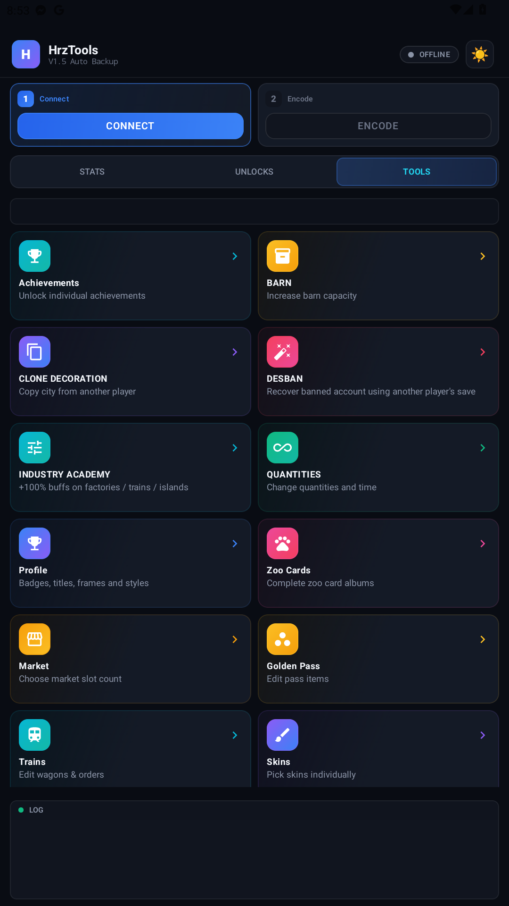
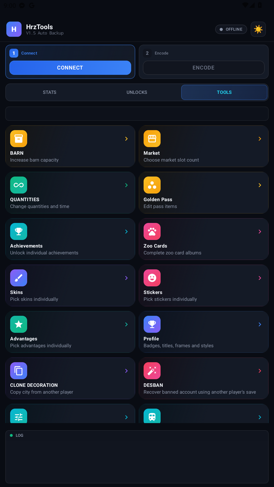
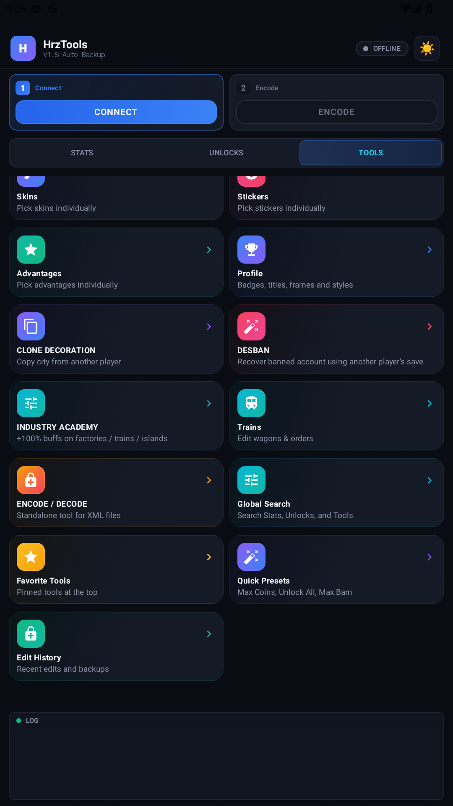

# HrzTools — UI Overhaul (Feature Button Grid)

Modifikasi tampilan (UI/UX) untuk aplikasi **HrzTools** (`com.twntool.editor`) — merombak layout tombol fitur di tab **TOOLS** agar lebih rapi, ringkas, dan enak dilihat. Patch dilakukan pada level **Smali bytecode** (APK patching), tanpa source Kotlin asli.

> ⚠️ **Disclaimer.** Repo ini untuk keperluan belajar & penggunaan pribadi (personal reverse-engineering / UI tinkering). Tidak mendistribusikan kode sumber pihak ketiga — hanya berisi *diff* perubahan yang dibuat sendiri, dokumentasi, screenshot, dan artefak build. Gunakan dengan tanggung jawab sendiri.

---

## ✨ Ringkasan Perubahan

Dua perbaikan pada layar **TOOLS** (`ToolsScreenKt` / composable `ToolCardCompact`):

### 1. Polish visual kartu
| Properti | Sebelum | Sesudah |
| :--- | :---: | :---: |
| Tinggi kartu (fixed) | `108dp` | **`94dp`** — lebih ramping, tak boros ruang |
| Radius sudut kartu | `12dp` | **`16dp`** — lebih modern / soft |
| Jarak antar-baris grid | `8dp` | **`10dp`** — lebih lega |

Hasil: grid muat **~1 baris lebih banyak** per layar tanpa terasa sesak.

### 2. Penataan ulang urutan tombol (grup by fungsi)
Sebelumnya urutan mengikuti default game (acak secara logika). Sekarang dikelompokkan:

| Grup | Tombol |
| :--- | :--- |
| 💰 **Ekonomi** | Barn · Market · Quantities · Golden Pass |
| 🔓 **Unlock** | Achievements · Zoo Cards · Skins · Stickers · Advantages · Profile |
| 👤 **Akun** | Clone Decoration · Desban · Industry Academy · Trains |
| 🛠️ **Utilitas** | Encode/Decode · Global Search · Favorite Tools · Quick Presets · Edit History |

---

## 📸 Before / After

| Sebelum | Sesudah (atas) | Sesudah (bawah) |
| :---: | :---: | :---: |
|  |  |  |

---

## 🔧 Detail Teknis

Semua perubahan ada di satu file:
`smali_classes3/com/twntool/editor/ui/screens/ToolsScreenKt.smali`

**Temuan kunci:** posisi tombol di grid ditentukan oleh **indeks array** pada instruksi
`aput-object vItem, v3, vIndex` — *bukan* urutan fisik blok kode. Jadi penataan ulang
cukup dengan mengubah konstanta indeks (`const/4` / `const/16`) sebelum tiap `aput-object`,
tanpa memindahkan blok apa pun. (Perhatikan: `const/4` maksimum `0x7`; indeks ≥ 8 pakai `const/16`.)

Patch lengkap: [`patches/ToolsScreen_ui_overhaul.diff`](patches/ToolsScreen_ui_overhaul.diff) (17 baris perubahan).

---

## 🏗️ Build & Install

Prasyarat: `apktool`, `uber-apk-signer`, `adb`, dan folder hasil decompile APK.

```bash
# 1. Terapkan patch ke folder decompile
patch -p1 -d bongkar/apktool_v13/smali_classes3/com/twntool/editor/ui/screens \
      < patches/ToolsScreen_ui_overhaul.diff

# 2. Rebuild APK
java -jar tools/apktool.jar b bongkar/apktool_v13 -o HrzTools_UI-Overhaul.apk

# 3. Zipalign + sign (debug key)
java -jar tools/uber-apk-signer.jar --apks HrzTools_UI-Overhaul.apk

# 4. Install ke device/emulator
adb install -r HrzTools_UI-Overhaul-aligned-debugSigned.apk
```

APK siap-pakai tersedia di **[Releases](../../releases)** dan di folder [`build/`](build/).

---

## ✅ Status

Sudah di-build, di-sign, dan **dites langsung di emulator Android** — grid TOOLS ter-render
penuh (19 kartu) dengan urutan & tampilan baru, tanpa crash/regresi.
